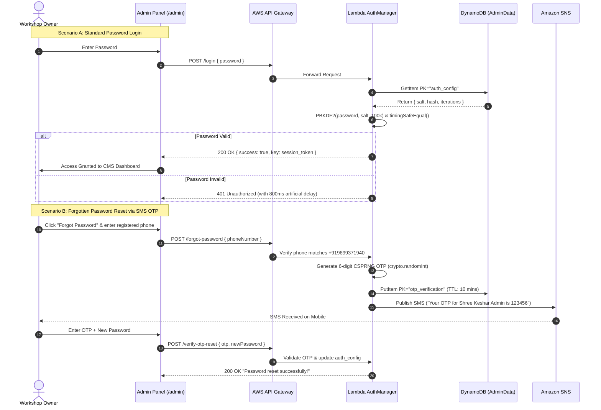

# PROJECT OVERVIEW: SHREE KESHAR FABRICATION WORKS (श्री केशर फॅब्रिकेशन वर्क्स)

> **Document Version**: 2.0.0 (Production Release)  
> **Last Updated**: October 2026  
> **Project Type**: Cloud-Native Full-Stack Web Application & Digital Presence System  
> **Academic Context**: Web Technology Laboratory (WTL) Capstone Engineering Project  
> **Repository**: [Ajijars/Shree-Keshar-Fabrication](https://github.com/Ajijars/Shree-Keshar-Fabrication)  
> **Live Production Domain**: [https://main.dnhik5dayaggh.amplifyapp.com](https://main.dnhik5dayaggh.amplifyapp.com)

---

## 1. EXECUTIVE SUMMARY & BRAND IDENTITY

**Shree Keshar Fabrication Works (श्री केशर फॅब्रICATION वर्क्स)** is a premier, artisanal metal fabrication and sacred vehicle engineering enterprise based in Kolhar Khurd, Taluka Rahuri, District Ahilyanagar (Ahmednagar), Maharashtra. 

The workshop specializes in the custom architectural design, structural engineering, restoration, and modern mechanical retrofitting of **Temple Chariots (देवस्थान रथ)**, **Pilgrimage Palanquins (दिंडी व पालखी रथ)** for historic Maharashtrian yatras (such as the sacred **Pandharpur Ashadhi Ekadashi Wari**, **Alandi-Dehu Palkhi Sohala**, and local village jatra festivals), as well as heavy-duty agricultural trailers and architectural metalwork.

This project delivers an enterprise-grade, cloud-native, bilingual digital ecosystem designed to:
1. Provide rural temple trusts (*देवस्थान ट्रस्ट*), gram panchayats, and dindi mandals with transparent pricing, technical specifications, and structural options via an **Interactive Rath Cost & Specification Estimator**.
2. Showcase high-definition visual proof of 25+ years of artisanal craftsmanship through an **S3-backed Media Gallery with Lightbox Inspection**.
3. Facilitate frictionless mobile-first customer inquiries via **WhatsApp Deep-Linking** and direct **Google Maps navigation**.
4. Empower non-technical workshop owners to manage site content, prices, gallery photos, and contact numbers via a **PBKDF2-secured, Zero-Idle-Cost Serverless Administrative CMS**.
5. Supply print-ready, high-resolution physical offline branding through a custom **30" × 12' Flex Workshop Poster/Banner** generated via HTML5/CSS3 vector canvas.

---

## 2. PHYSICAL WORKSHOP & CONTACT SPECIFICATIONS

| Parameter | Official Record |
|:---|:---|
| **Enterprise Name** | श्री केशर फॅब्रिकेशन वर्क्स (Shree Keshar Fabrication Works) |
| **Founder / Head Craftsman** | श्री. प्रभाकर म्हसके (Shri Prabhakar Mhaske) |
| **Co-Owner / Fabrication Lead**| श्री. हर्ष म्हसके (Shri Harsh Mhaske) |
| **Primary Calling & WhatsApp**| `+91 96993 71940` |
| **Alternate Workshop Lines** | `+91 97667 52029` / `+91 99227 52029` |
| **Official Email** | `shreekesharfabrication@gmail.com` |
| **Physical Workshop Address** | Near Pravara Madhyamik Vidyalaya, Kolhar Khurd (Nagar-Manmad Highway), Tal: Rahuri, Dist: Ahilyanagar (Ahmednagar), Maharashtra – 413710 |
| **Active Google Maps Query** | [Open in Google Maps](https://www.google.com/maps/search/?api=1&query=Shree+Keshar+Fabrication+Works+Kolhar+khurd+Rahuri+Ahilyanagar) |
| **Operational Track Record** | 25+ Years of Tradition, 100+ Temple Chariots Delivered Across Maharashtra |

---

## 3. CORE ARCHITECTURE & SYSTEM DESIGN

The system follows a modern **Three-Tier Serverless Single Page Application (SPA)** architecture deployed on Amazon Web Services (AWS) in the assigned project region **`ap-southeast-2` (Sydney)**.

```mermaid
flowchart TD
    subgraph ClientTier ["Client Tier (Browser & Mobile Devices)"]
        User["Visitor / Temple Trust / Warkari"]
        AdminUser["Workshop Administrator (Harsh / Prabhakar)"]
        ViteSPA["React 19 + Tailwind v4 SPA\n(Bilingual Devanagari/English)"]
        PrintBanner["30in x 12ft Flex Banner Canvas\n(workshop-banner.html)"]
        User --> ViteSPA
        AdminUser --> ViteSPA
    end

    subgraph CDNAndHosting ["CDN & Edge Hosting (AWS Amplify)"]
        AmplifyEdge["AWS Amplify Global CDN\n(App ID: dnhik5dayaggh)\nAutomatic SSL & HSTS"]
        ViteSPA <-->|HTTPS Assets / SPA Routing| AmplifyEdge
    end

    subgraph DirectIntegrations ["Direct External Integrations"]
        WhatsAppAPI["WhatsApp URI Deep-Link\n(wa.me/919699371940)"]
        GoogleMaps["Google Maps Navigation API"]
        ViteSPA -->|Estimator & Inquiry Dispatch| WhatsAppAPI
        ViteSPA -->|Directions & Workshop Map| GoogleMaps
    end

    subgraph ServerlessBackend ["Serverless Backend Tier (AWS ap-southeast-2)"]
        APIGateway["Amazon API Gateway REST Proxy\n(https://9n5fxaqqel.execute-api.ap-southeast-2...)"]
        Lambda["AWS Lambda Function (Node.js 20 ES Modules)\nClean Architecture OOP Factory Pattern"]
        
        ViteSPA -->|REST API Calls (x-admin-key)| APIGateway
        APIGateway -->|Proxy Event Payload| Lambda
    end

    subgraph StorageAndData ["Cloud Data & Notification Tier"]
        DynamoDB[("Amazon DynamoDB (Single-Table: AdminData)\nCMS Config, Passwords, OTP Tokens")]
        S3Bucket[("Amazon S3 Bucket\n(shree-keshar-fabrication-gallery)\nGallery Images & Thumbnails")]
        SNS["Amazon SNS (Transactional SMS Gateway)\n6-Digit OTP Delivery to +919699371940"]
        
        Lambda <-->|Query & Put Items| DynamoDB
        Lambda -->|Base64 Stream Uploads| S3Bucket
        Lambda -->|Publish SMS| SNS
    end
```

---

## 4. DETAILED TECHNOLOGY STACK & VERSION MATRIX

### 4.1 Frontend Tier
| Technology | Version | Purpose & Architectural Role |
|:---|:---|:---|
| **React** | `19.2.8` | Core UI library using concurrent rendering, functional components, and custom hooks. |
| **React DOM** | `19.2.8` | DOM renderer for React 19. |
| **Vite** | `8.2.0` | Next-generation build tool and dev server featuring instantaneous Hot Module Replacement (HMR). |
| **Tailwind CSS** | `4.3.3` | Utility-first styling engine running via `@tailwindcss/vite` plugin with custom devotional tokens. |
| **React Router DOM** | `7.18.2` | Client-side routing, nested layout management, 404 wildcard trapping, and scroll restoration. |
| **Lucide React** | `1.31.0` | Ultra-crisp SVG icon suite for mechanical, religious, administrative, and communication controls. |
| **React Helmet Async**| `3.0.0` | Head document manager injecting localized OpenGraph, canonical URLs, and dynamic page titles. |
| **React Hot Toast** | `2.6.1` | Lightweight, accessible notification toasts for admin actions and contact feedback. |

### 4.2 Backend & Cloud Infrastructure
| Component | Implementation Details |
|:---|:---|
| **Runtime** | Node.js 20.x LTS running ECMAScript Modules (`.mjs`). |
| **Compute** | **AWS Lambda** (`arn:aws:lambda:ap-southeast-2:117281298608:function:...`), stateless execution with 0 idle cost. |
| **API Management** | **Amazon API Gateway** (REST API `9n5fxaqqel`), CORS origin whitelisting, HTTP proxy integration. |
| **Database** | **Amazon DynamoDB** (`AdminData` table), single-table design, single-digit millisecond reads/writes. |
| **Object Storage** | **Amazon S3** (`shree-keshar-fabrication-gallery`), optimized media storage with public read policies. |
| **Telecom Messaging**| **Amazon SNS** (Simple Notification Service), transactional SMS OTP dispatcher. |
| **Static Hosting** | **AWS Amplify Hosting** (`dnhik5dayaggh`), custom branch `main`, global CloudFront CDN edge caching. |
| **AWS CLI & Tools** | AWS CLI v2.37.12, AWS Agent Toolkit (`ap-southeast-2` region, `shree-keshar-fabrication` profile). |
| **Code Linter** | **Oxlint** (`v1.75.0`), Rust-based ultra-fast linter auditing 62 files in < 70ms with zero warnings. |

---

## 5. REPOSITORY DIRECTORY STRUCTURE & FILE MANIFEST

```
c:\WTL_Shree_keshar_fabrication\
├── .gitignore                      # Git exclusion rules (node_modules, dist, .env)
├── .oxlintrc.json                  # Oxlint linter configuration
├── AGENTS.md                       # AWS Agent Toolkit & Region rules (ap-southeast-2)
├── CLAUDE.md                       # Development instructions and project constraints
├── README.md                       # Quickstart and overview guide
├── WTL_PROJECT_REPORT.md           # Academic end-semester practical project report
├── PROJECT_OVERVIEW.md             # This comprehensive master specification file
├── amplify.yml                     # AWS Amplify CI/CD build specification
├── deploy-amplify.ps1              # Automated PowerShell manual deployment pipeline
├── index.html                      # Single Page Application HTML entry point
├── package.json                    # Node dependencies, scripts, and engine metadata
├── vite.config.js                  # Vite bundler plugins and Tailwind v4 setup
├── workshop-banner.html            # 30" x 12' Flex Workshop Print Banner generator
│
├── backend-lambda/                 # Serverless AWS Lambda Source Code
│   ├── index.mjs                   # Main Lambda request router & CORS handler
│   ├── function.zip                # Packaged deployment bundle
│   └── services/                   # Clean Architecture Service Layer
│       ├── BaseService.mjs         # Base service with standardized HTTP responses & CORS
│       ├── AuthManager.mjs         # PBKDF2 hashing, timingSafeEqual checks, recovery PIN
│       ├── OTPService.mjs          # CSPRNG OTP generator, DynamoDB cooldown tracking, SNS SMS
│       ├── UploadService.mjs       # Base64 decoder, MIME validator, S3 streaming client
│       ├── DataService.mjs         # DynamoDB live CMS state retrieval and persistence
│       ├── ForgotPasswordService.mjs # Owner authorization & OTP dispatch orchestrator
│       ├── OtpResetService.mjs     # OTP verification & credential update handler
│       └── ServiceFactory.mjs      # Dynamic service instantiation factory
│
├── public/                         # Public Static Assets
│   ├── favicon.ico                 # Site favicon
│   ├── manifest.json               # Web App Manifest
│   └── images/                     # Static Fallback Assets & Portfolio Photos
│       ├── logo.png                # Official Shree Keshar circular crest logo
│       ├── hero.jpg                # Workshop hero banner image
│       ├── shop.jpg                # Workshop premises exterior photo
│       ├── about.jpg               # Craftsmanship and fabrication overview photo
│       ├── devotional.jpg          # Vitthal-Rukmini spiritual background
│       ├── owner-prabhakar.jpg     # Shri Prabhakar Mhaske profile photo
│       ├── owner-harsh.jpg         # Shri Harsh Mhaske profile photo
│       └── gallery/                # Rath Portfolio Photography (rath-1.jpg to rath-16.jpg)
│
└── src/                            # React 19 Application Source Code
    ├── App.jsx                     # Master application router & provider nesting
    ├── main.jsx                    # React 19 concurrent root initialization
    ├── index.css                   # Tailwind v4 directives, custom font imports & utilities
    │
    ├── admin/                      # Administrative Control Center (CMS)
    │   ├── AdminGuard.jsx          # Route protection guard checking authentication state
    │   ├── AdminLayout.jsx         # Administrative dashboard shell, sidebar, and header
    │   ├── AdminDashboard.jsx      # Portal overview, analytics stats, and quick links
    │   ├── AdminLogin.jsx          # PBKDF2 login form with SMS OTP & Master PIN recovery
    │   ├── AdminGallery.jsx        # S3 media manager: upload, delete, reorder, preview
    │   ├── AdminServices.jsx       # Service cards editor, pricing updater, Devanagari text
    │   ├── AdminOwners.jsx         # Proprietor biography and contact detail management
    │   ├── AdminContact.jsx        # Workshop phone, address, and Google Maps URL editor
    │   ├── AdminSettings.jsx       # Social links, SEO settings, and password update portal
    │   ├── AdminContext.jsx        # Administrative React Context synchronizing with DynamoDB
    │   └── PageIndicator.jsx       # Helper component indicating public pages affected by edits
    │
    ├── components/                 # Reusable Modular UI Components
    │   ├── About.jsx               # Heritage, mission, and workshop credentials component
    │   ├── BackToTopButton.jsx     # Floating smooth-scroll return-to-top button
    │   ├── ContactForm.jsx         # Contact inquiry form with validation & WhatsApp fallback
    │   ├── DevotionalTicker.jsx    # Marquee ticker with auspicious devotional chants
    │   ├── FAQ.jsx                 # Accordion-based frequently asked questions
    │   ├── Footer.jsx              # Comprehensive footer with Google Maps badge & quick links
    │   ├── Gallery.jsx             # Public media gallery with category filtering & Lightbox
    │   ├── Hero.jsx                # High-impact hero section with primary CTAs
    │   ├── HomeCTA.jsx             # Bottom conversion call-to-action banner
    │   ├── HomeEstimatorTeaser.jsx # Interactive homepage teaser card for Rath Estimator
    │   ├── HomeHighlights.jsx      # Stat counters (25+ years, 100+ raths, 100% guarantee)
    │   ├── HomeIntro.jsx           # Welcome intro highlighting rural Maharashtrian heritage
    │   ├── HomeServicesPreview.jsx # Highlighting primary fabrication services
    │   ├── ImagePlaceholder.jsx    # Graceful fallback component for delayed image loads
    │   ├── LanguageSwitcher.jsx    # Compact Marathi (मराठी) / English (EN) toggle pill
    │   ├── Layout.jsx              # Public site wrapper with Navbar, Footer, and Floating CTAs
    │   ├── MobileQuickBar.jsx      # Sticky bottom bar for one-tap calling & WhatsApp on phones
    │   ├── Navbar.jsx              # Sticky responsive navigation with mobile sliding drawer
    │   ├── Owners.jsx              # Proprietor profiles showcasing credentials and experience
    │   ├── PageBanner.jsx          # Reusable header banner for inner pages
    │   ├── RathEstimator.jsx       # Dynamic cost & engineering specification calculator
    │   ├── ScrollProgressBar.jsx   # Top golden reading-progress bar
    │   ├── ScrollToTop.jsx         # Scroll reset helper on client-side route changes
    │   ├── SectionHeading.jsx      # Standardized ornate section headers with saffron motifs
    │   ├── ServiceAreas.jsx        # Geographic reach list (Ahilyanagar, Pune, Solapur, Nashik)
    │   ├── ServiceProcess.jsx      # Step-by-step Rath manufacturing workflow (Design to Delivery)
    │   ├── Services.jsx            # Comprehensive service cards with pricing indicators
    │   ├── SiteImage.jsx           # Enhanced image wrapper with fallback and loading spinners
    │   ├── Testimonials.jsx        # Real reviews from temple trustees and warkari mandals
    │   ├── TrustTicker.jsx         # Trust badges (Certified Materials, Hydraulic Brakes, Warranty)
    │   ├── WhatsAppFloat.jsx       # Floating green WhatsApp button with pulsing animation
    │   └── WhyChooseUs.jsx         # Competitive differentiators and structural guarantees
    │
    ├── data/                       # Static Data Defaults
    │   └── siteData.js             # Initial fallback contact, owner, and gallery constants
    │
    ├── hooks/                      # Custom React Hooks
    │   ├── useAdmin.js             # Hook for interacting with AdminContext state
    │   └── useTranslation.js       # Hook for accessing localized dictionary strings
    │
    ├── i18n/                       # Internationalization Subsystem
    │   ├── LanguageContext.jsx     # Context provider managing selected language & HTML lang
    │   └── translations/
    │       ├── mr.js               # Complete Marathi translation dictionary (देवनागरी)
    │       └── en.js               # Complete English translation dictionary
    │
    └── pages/                      # Page Level Views
        ├── HomePage.jsx            # Full homepage composition
        ├── AboutPage.jsx           # Workshop history, values, and manufacturing capability
        ├── ServicesPage.jsx        # Detailed service catalog & Rath Estimator modal
        ├── GalleryPage.jsx         # Complete photo and video portfolio
        ├── OwnersPage.jsx          # Meet the craftsmen (Prabhakar & Harsh Mhaske)
        ├── ContactPage.jsx         # Interactive Google Map, contact cards, and inquiry form
        └── NotFoundPage.jsx        # Culturally themed 404 error page with quick redirects
```

---

## 6. KEY FUNCTIONAL MODULES & USER JOURNEYS

### 6.1 Bilingual Localization Engine (i18n)
- **Files**: `src/i18n/LanguageContext.jsx`, `src/i18n/translations/mr.js`, `src/i18n/translations/en.js`.
- **Functionality**:
  - Automatically identifies stored user preference in `localStorage.getItem("keshar_lang")`. Defaults to Marathi (`mr`) as the primary regional cultural language.
  - Dynamically injects Devanagari typography (`Rozha One`, `Noto Sans Devanagari`, `Tiro Devanagari Marathi`) for Marathi, and `Outfit` / `Playfair Display` for English.
  - Switches UI text instantly across all routes without requiring network roundtrips or page reloads.

### 6.2 Interactive Rath Cost & Specification Estimator
- **Files**: `src/components/RathEstimator.jsx`, `src/components/HomeEstimatorTeaser.jsx`.
- **Calculation Parameters**:
  1. **Chariot Archetype**:
     - *Dindi Yatra Palkhi Rath (दिंडी व पालखी रथ)*: Optimized for walking pilgrimages, lightweight, high-tensile axle.
     - *Grand Temple Chariot (भव्य देवस्थान रथ)*: Multi-tier architectural towers, brass cladding, ornate wooden filigree.
     - *Procession Carriage (उत्सव मिरवणूक रथ)*: Compact, high-maneuverability urban festival carrier.
     - *Rath Restoration & Retrofitting (रथ दुरुस्ती व नूतनीकरण)*: Chassis strengthening, new braking, repainting.
  2. **Scale & Height**: 4–6 ft, 7–10 ft, 11–15 ft, or Custom Multi-Tier.
  3. **Engineering Add-Ons**:
     - *Heavy-duty Hydraulic Disc Braking (हायड्रॉलिक ब्रेक सिस्टीम)* — Crucial for steep ghat sections during Payi Yatra.
     - *Integrated Sound & Inverter Battery Housing (ध्वनिक्षेपक व बॅटरी व्यवस्था)*.
     - *Weatherproof Monsoon Canopy (वॉटरप्रूफ छत)*.
     - *Decorative Pure Brass Kalash & Filigree (पितळी नक्षीकाम व कळस)*.
     - *High-Lumen Golden LED Festive Illumination (एलईडी लायटिंग)*.
- **Conversion Flow**:
  - Dynamically calculates estimated investment bracket (e.g., ₹1,50,000 – ₹3,50,000) and delivery timeline (e.g., 3–5 weeks).
  - Generates an automated, structured WhatsApp message payload and invokes `window.open("https://wa.me/919699371940?text=...")` for instant direct consultation.

### 6.3 Dynamic Media Gallery with S3 Storage & Lightbox
- **Files**: `src/components/Gallery.jsx`, `src/admin/AdminGallery.jsx`.
- **Features**:
  - Real-time synchronization between DynamoDB item store and public view.
  - Category filtering: *सर्व (All)*, *पालखी रथ (Palkhi Rath)*, *देवस्थान रथ (Temple Chariot)*, *नूतनीकरण (Restoration)*.
  - Keyboard-accessible Lightbox with Left/Right arrow navigation, touch swipe support, and Escape key dismissal.
  - Administrative upload utility supporting direct base64 encoding, client-side 8MB threshold validation, and automated S3 key generation.

### 6.4 Dual-Channel Lead Acquisition & Interactive Map
- **Files**: `src/components/ContactForm.jsx`, `src/pages/ContactPage.jsx`, `src/components/Footer.jsx`.
- **Integrations**:
  - Embedded responsive Google Map iframe pinpointing Kolhar Khurd on the Nagar-Manmad highway.
  - "Google Maps वर दिशा मिळवा (Get Directions)" button triggering native Google Maps turn-by-turn navigation on mobile devices.
  - Clickable phone links (`tel:+919699371940`) and email links (`mailto:shreekesharfabrication@gmail.com`).
  - Web3Forms API dispatch with intelligent automated fallback to pre-formatted WhatsApp chat.

---

## 7. SECURE ADMINISTRATIVE CMS (`/admin`)

The Administrative CMS allows workshop owners to modify website content in real time from any phone or computer without touching code.



### Administrative Modules
1. **फोटो व्यवस्थापन (Gallery Management)**: Add high-resolution photos, attach bilingual captions, categorize, reorder via move up/down controls, or delete images.
2. **सेवा व किंमत (Services & Pricing)**: Edit service titles, descriptions, starting prices, and turn-around times.
3. **मालक व कार्यशाळा (Owners & Workshop)**: Update proprietor biographies, experience years, and upload fresh workshop photos.
4. **संपर्क माहिती (Contact Info)**: Update phone numbers, WhatsApp dispatch number, physical address, and Google Maps query strings.
5. **सेटिंग्ज (Settings)**: Change admin password, manage social media URLs, and view audit metadata.

---

## 8. BACKEND CLEAN ARCHITECTURE & OOP SERVICE FACTORY

The serverless Lambda backend (`backend-lambda/`) is structured according to **Clean Architecture** and the **Service Factory Pattern**, isolating discrete domain responsibilities into modular ES classes.

```
backend-lambda/
├── index.mjs                         # Lambda Entry Handler & Routing Switch
└── services/
    ├── BaseService.mjs               # Shared CORS headers, Origin whitelist, JSON responses
    ├── AuthManager.mjs               # PBKDF2-SHA512 hashing, timingSafeEqual, recovery PIN
    ├── OTPService.mjs                # CSPRNG token generator, rate limiter, SNS SMS publisher
    ├── UploadService.mjs             # Base64 decoder, MIME validator, S3 client
    ├── DataService.mjs               # DynamoDB CMS state manager
    ├── ForgotPasswordService.mjs     # SMS OTP reset initiation workflow
    ├── OtpResetService.mjs           # OTP verification and password update workflow
    └── ServiceFactory.mjs            # Factory class providing lazy-initialized service singletons
```

### Key Service Responsibilities
- **`BaseService`**: Centralizes CORS compliance. Rejects unauthorized origins, verifies `x-admin-key` against current credentials, and standardizes `{ success: true, ... }` response payloads.
- **`AuthManager`**: Manages PBKDF2 key derivation (100,000 iterations, 32-byte salt), constant-time byte comparisons via `crypto.timingSafeEqual`, and emergency offline Master PIN overrides.
- **`OTPService`**: Eliminates insecure random number generators by utilizing Node's cryptographically secure pseudo-random integer generator (`crypto.randomInt(100000, 1000000)`). Enforces a 60-second dispatch cooldown and a 10-minute time-to-live (TTL).
- **`UploadService`**: Sanitizes incoming filenames, blocks non-image MIME types, enforces an 8MB upload cap, and streams the buffer directly to Amazon S3 with `public-read` ACL.

---

## 9. DATABASE DESIGN (AMAZON DYNAMODB)

The project leverages a **Single-Table DynamoDB Schema** (`TableName: AdminData`, Region: `ap-southeast-2`), optimizing cost, backup maintenance, and query latency.

### Entity Schemas

#### 1. Site Content Record (`PK: "admin"`)
```json
{
  "id": "admin",
  "updatedAt": "2026-10-20T13:54:07.123Z",
  "data": {
    "gallery": [
      {
        "id": "1730000000001",
        "src": "/images/gallery/rath-1.jpg",
        "captionMr": "भव्य पालखी रथ (पंढरपूर वारी)",
        "captionEn": "Grand Palkhi Rath (Pandharpur Wari)",
        "category": "rath"
      }
    ],
    "services": [
      {
        "id": "palkhi-rath",
        "titleMr": "पालखी व दिंडी रथ निर्मिती",
        "titleEn": "Palkhi & Dindi Rath Fabrication",
        "descMr": "वारकरी दिंडीसाठी मजबूत, वजनाने संतुलित व हायड्रॉलिक ब्रेक असलेले रथ.",
        "descEn": "Sturdy, balanced raths with hydraulic brakes for warkari dindis.",
        "priceNoteMr": "किंमत कामाच्या स्वरूपानुसार",
        "priceNoteEn": "Price based on specifications"
      }
    ],
    "contact": {
      "phone": "+91 96993 71940",
      "whatsapp": "919699371940",
      "email": "shreekesharfabrication@gmail.com",
      "address": "Near Pravara madhyamik vidyalaya, Kolhar khurd (Nagar-Manmad highway), Tal: Rahuri, Dist: Ahilyanagar, Maharashtra",
      "mapLink": "https://www.google.com/maps/search/?api=1&query=Shree+Keshar+Fabrication+Works+Kolhar+khurd+Rahuri+Ahilyanagar"
    },
    "owners": {
      "prabhakar": {
        "phone": "+91 96993 71940",
        "image": "/images/owner-prabhakar.jpg"
      },
      "harsh": {
        "phone": "+91 96993 71940",
        "image": "/images/owner-harsh.jpg"
      }
    },
    "social": {
      "facebook": "#",
      "instagram": "#",
      "youtube": "#"
    }
  }
}
```

#### 2. Authentication Record (`PK: "auth_config"`)
```json
{
  "id": "auth_config",
  "hash": "e7b8f9a0c1d2e3f4... (64-byte hex string)",
  "salt": "a1b2c3d4e5f6... (32-byte hex string)",
  "iterations": 100000,
  "recoveryPin": "969937",
  "updatedAt": "2026-10-15T10:30:00.000Z"
}
```

#### 3. OTP Verification Record (`PK: "otp_verification"`)
```json
{
  "id": "otp_verification",
  "hash": "5d41402abc4b2a76b9719d911017c592...",
  "salt": "f2a1b9...",
  "phone": "+919699371940",
  "attempts": 0,
  "expiresAt": 1792504800000,
  "lastSentAt": 1792504200000
}
```

---

## 10. RESTful API SPECIFICATION

Base URL: `https://9n5fxaqqel.execute-api.ap-southeast-2.amazonaws.com`

| Route | Method | Authorization | Request Body | Success Response | Error Code | Description |
|:---|:---:|:---:|:---|:---|:---:|:---|
| `/` | `GET` | Public | None | `{ data: { ... } }` | `500` | Fetches active live CMS data from DynamoDB. |
| `/login` | `POST` | Public | `{ password: "..." }` | `{ success: true, key: "..." }` | `401` | Validates admin password against PBKDF2 hash. |
| `/forgot-password` | `POST` | Public | `{ phoneNumber: "+919699371940" }` | `{ success: true, message: "OTP sent" }` | `400, 429` | Validates owner phone, enforces 60s cooldown, dispatches SMS OTP. |
| `/verify-otp-reset`| `POST` | Public | `{ otp: "123456", newPassword: "..." }` | `{ success: true, message: "Reset complete" }` | `400, 403` | Validates OTP token and updates credentials in DynamoDB. |
| `/reset-with-pin` | `POST` | Public | `{ recoveryPin: "...", newPassword: "..." }` | `{ success: true, message: "Reset complete" }` | `401` | Emergency password reset via offline master recovery PIN. |
| `/change-password`| `POST` | Auth (`x-admin-key`) | `{ currentPassword: "...", newPassword: "..." }` | `{ success: true, message: "Updated" }` | `401` | Updates password from an authenticated session. |
| `/data` | `POST` | Auth (`x-admin-key`) | `{ data: { gallery, services, ... } }` | `{ success: true, message: "Saved" }` | `401, 500` | Overwrites CMS site configuration in DynamoDB. |
| `/upload` | `POST` | Auth (`x-admin-key`) | `{ base64Data: "...", filename: "...", contentType: "image/jpeg" }` | `{ success: true, url: "https://...", key: "..." }` | `400, 401` | Decodes base64 buffer and uploads media file to Amazon S3. |

---

## 11. SECURITY, CRYPTOGRAPHY & OWASP MITIGATION MATRIX

| Security Threat | OWASP Category | Implemented Defensive Control in Project |
|:---|:---|:---|
| **Credential Cracking / Brute Force** | A07:2021 Identification & Auth Failures | Password hashing with PBKDF2 using SHA-512, 100,000 iterations, unique 32-byte salt; artificial 800ms timing jitter delay on failure. |
| **Side-Channel Timing Attacks** | A02:2021 Cryptographic Failures | Comparisons executed using `crypto.timingSafeEqual(bufferA, bufferB)` ensuring execution duration remains identical regardless of mismatched byte positions. |
| **Predictable OTP Enumeration** | A02:2021 Cryptographic Failures | Generated using CSPRNG `crypto.randomInt(100000, 1000000)`. Maximum 5 validation attempts before immediate token destruction. |
| **Unauthorized SMS Bombing** | A04:2021 Insecure Design | Hardened restriction: SMS OTP dispatch requests are strictly rejected unless the target phone matches the verified proprietor phone (`+919699371940`). Enforces mandatory 60-second cooldown. |
| **CORS Exploitation & Data Theft** | A05:2021 Security Misconfiguration | Strict origin whitelisting in `BaseService.mjs` restricted to production domains (`shreekesharfabrication.in`, `amplifyapp.com`, and localhost during development). Wildcard `*` origins are strictly forbidden. |
| **Clickjacking & Redress Attacks** | A05:2021 Security Misconfiguration | HTTP security headers configured in `amplify.yml`: `X-Frame-Options: SAMEORIGIN`, `X-Content-Type-Options: nosniff`, `Strict-Transport-Security: max-age=31536000; includeSubDomains`. |
| **Stored Cross-Site Scripting (XSS)** | A03:2021 Injection | Client-side input sanitization via `sanitizeInput()` stripping dangerous script characters before state updates, combined with React's native JSX escaping. |
| **Session Inactivity Exposure** | A07:2021 Identification & Auth Failures | Client-side inactivity listener automatically invalidates credentials and logs out after 30 minutes of no mouse/keyboard activity. |

---

## 12. PHYSICAL WORKSHOP BANNER SPECIFICATION (`workshop-banner.html`)

For physical workshop branding, an interactive vector banner canvas is maintained in [workshop-banner.html](file:///c:/WTL_Shree_keshar_fabrication/workshop-banner.html).

### Technical Dimensions & Print Specifications
- **Physical Print Size**: **30 Inches Height × 12 Feet Width** (2.5 ft × 12 ft / 144" × 30").
- **Digital Canvas Grid**: `4800px × 1000px` (4.8:1 aspect ratio matching real-world flex printing proportions).
- **Print Resolution**: Formatted for 300 DPI high-definition flex/vinyl banner output (`@media print` rules configured for `144in × 30in` landscape page box).
- **Core Visual Layout**:
  1. **Top Ornate Ribbon**: Traditional saffron and gold devotional marquee displaying *"॥ श्री विठ्ठल-रुक्मिणी प्रसन्न ॥"* in classical Devanagari calligraphy.
  2. **Official Crest**: Circular 310px golden-bordered frame containing the official Shree Keshar emblem.
  3. **Main Shop Title**: Rendered in **215px Rozha One** Devanagari typography with a metallic 3D golden gradient, subtle drop shadow, and crisp white highlight contour.
  4. **Key Offerings (Feature Cards)**:
     - *देवस्थान व पालखी रथ (Palkhi & Temple Chariots)*
     - *अद्ययावत हायड्रॉलिक ब्रेक (Modern Hydraulic Braking)*
     - *पितळी व लाकडी कलाकुसर (Brass & Wood Craftsmanship)*
  5. **Proprietors & Stats Card**:
     - *श्री. प्रभाकर म्हसके (संस्थापक, ९६९९३ ७१९४०)*
     - *श्री. हर्ष म्हसके (सह-मालक)*
     - Badges: `२५+ वर्षे परंपरा`, `१००+ रथ निर्माण`, `१००% विश्वासू काम`.
  6. **Interactive QR Code**: Integrated vector QR code directing smartphone cameras straight to the live website.
  7. **Interactive Viewport Zoom Bar**: On-screen controls (`Fit Screen`, `लहान २५%`, `मध्यम ५०%`, `मोठा ७५%`, `अतिमोठा १००%`) allowing full inspections on standard PC monitors without horizontal scrollbar lockup.

---

## 13. DEVOPS, CONTINUOUS DEPLOYMENT & AUTOMATION

### 13.1 Repository Sync
The codebase is synchronized across two active Git remotes:
- **GitHub**: `https://github.com/Ajijars/Shree-Keshar-Fabrication.git`
- **AWS CodeCommit**: `codecommit::ap-southeast-2://shree-keshar-fabrication`

### 13.2 Automated AWS Amplify Deployment Script (`deploy-amplify.ps1`)
Because the Amplify application `dnhik5dayaggh` is configured for manual zip artifact deployments, the custom script `deploy-amplify.ps1` automates the entire delivery sequence:
1. Cancels any lingering unstarted jobs via `aws amplify stop-job` to prevent `BadRequestException` conflicts.
2. Invokes `aws amplify create-deployment` to generate a presigned S3 upload URL.
3. Transmits the production build archive (`dist.zip`) via `Invoke-RestMethod -Method Put`.
4. Triggers the deployment phase via `aws amplify start-deployment`.
5. Polls the Amplify Job status every 3 seconds until verified with status **`SUCCEED`**.

```powershell
# Usage to build and deploy to production
npm run build
npm run zip
.\deploy-amplify.ps1
```

### 13.3 CI/CD Build Configuration (`amplify.yml`)
```yaml
version: 1
frontend:
  phases:
    preBuild:
      commands:
        - npm ci
    build:
      commands:
        - npm run build
  artifacts:
    baseDirectory: dist
    files:
      - '**/*'
  cache:
    paths:
      - node_modules/**/*
  customHeaders:
    - pattern: '**/*'
      headers:
        - key: 'Strict-Transport-Security'
          value: 'max-age=31536000; includeSubDomains'
        - key: 'X-Frame-Options'
          value: 'SAMEORIGIN'
        - key: 'X-Content-Type-Options'
          value: 'nosniff'
```

---

## 14. LOCAL DEVELOPMENT & OPERATIONAL RUNBOOK

### 14.1 Local Development Environment Setup
```bash
# 1. Clone the repository
git clone https://github.com/Ajijars/Shree-Keshar-Fabrication.git
cd Shree-Keshar-Fabrication

# 2. Install dependencies
npm install

# 3. Start local development server (Hot Module Replacement)
npm run dev
# Running on http://localhost:5173

# 4. Execute high-speed code hygiene audit
npm run lint
# Powered by Oxlint: 0 warnings, 0 errors

# 5. Compile production bundle
npm run build
```

### 14.2 Administrative Credentials
- **Default Production Admin URL**: `/admin`
- **Default Password**: `keshar2024`
- **Emergency Offline Master PIN**: `969937`
- **Authorized Reset Mobile Phone**: `+91 96993 71940`

### 14.3 Client Browser Cache Troubleshooting
When newly deployed features (such as updated Google Maps hyperlinks or newly uploaded gallery photos) do not appear immediately in a visitor's browser:
- **Root Cause**: Browsers aggressively cache static JavaScript/CSS chunks in local memory/disk cache.
- **Immediate Resolution**:
  - Perform a Hard Refresh on desktop: **`Ctrl + F5`** or **`Ctrl + Shift + R`**.
  - On mobile devices: Open the page in a new **Incognito / Private Tab** or clear site storage in Chrome settings.

---

## 15. ACADEMIC PROJECT HIGHLIGHTS & VIVA QUESTIONS (WTL)

This project satisfies all requirements for the **Web Technology Laboratory (WTL)** curriculum:

1. **Why use React 19 over multi-page PHP/HTML?**  
   React 19 powers a Single Page Application (SPA) where language toggles (Marathi ↔ English) and page navigation happen instantaneously in the browser without full document reloading, dramatically cutting bandwidth usage on mobile connections.

2. **Why choose AWS Serverless (Lambda + DynamoDB) over an Express.js on EC2?**  
   An EC2 instance runs 24/7, accumulating continuous compute bills even during zero-traffic hours. AWS Lambda and DynamoDB operate on an event-driven pay-per-request model, resulting in virtually ₹0 idle hosting costs while guaranteeing automatic scaling during festival traffic spikes.

3. **How is customer inquiry friction minimized for rural clientele?**  
   Rural temple committees often dislike complicated multistep checkout carts. By integrating the **Rath Estimator** directly with **WhatsApp URI Deep-linking (`wa.me`)**, selected engineering specifications are converted into a pre-formatted message that opens directly in WhatsApp, preserving regional business dynamics.

4. **How are timing attacks mitigated during administrative authentication?**  
   Standard string comparisons (`===`) exit at the first mismatched byte, leaking execution duration clues to network attackers. The project utilizes `crypto.timingSafeEqual` over PBKDF2 hash buffers, guaranteeing that comparison time remains invariant regardless of how many characters match.

---

*Document compiled and verified for Shree Keshar Fabrication Works.*  
*Maintained by Engineering & Development Team | All Rights Reserved.*
