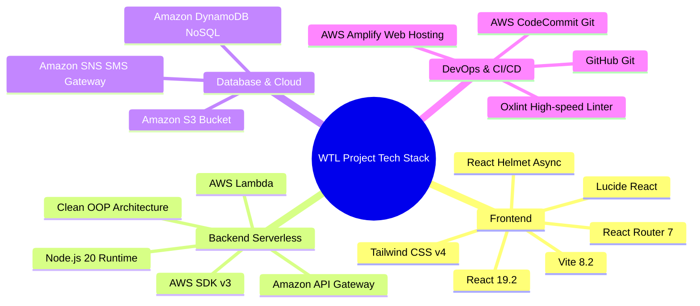
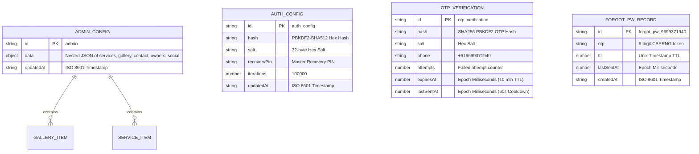
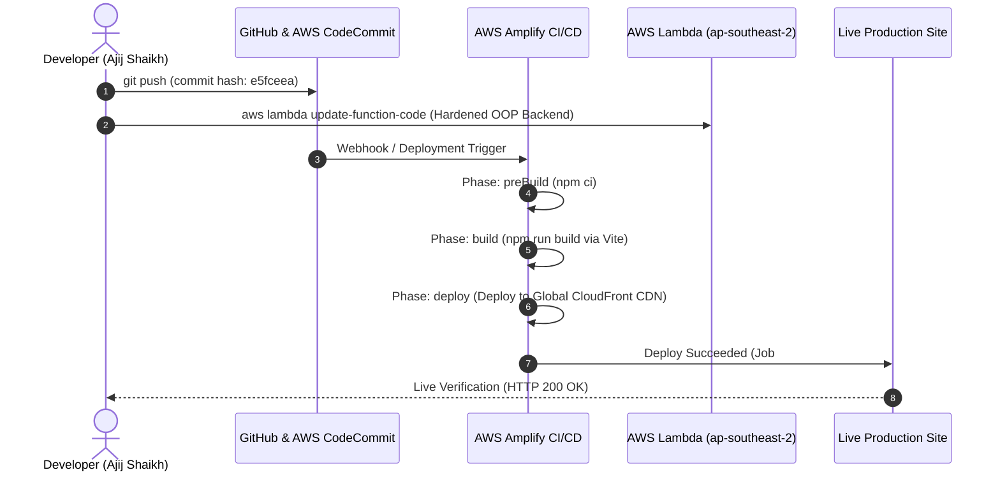

# WEB TECHNOLOGY LAB (WTL) — END-SEMESTER PRACTICAL PROJECT REPORT

---

## PROJECT TITLE:
### **Cloud-Native Full-Stack Web Application for Traditional Rath (Chariot) Engineering & Metal Fabrication: Shree Keshar Fabrication Works**

---

### **ACADEMIC DETAILS & SUBMISSION METADATA**

| Field | Details |
|---|---|
| **Course Name** | Web Technology Laboratory (WTL) |
| **Course Code** | [Enter Course Code, e.g., CS304 / IT304 / WTLLAB] |
| **Academic Year** | 2026 – 2027 |
| **Semester** | [Enter Semester, e.g., Semester VI / VII] |
| **Student Name** | Ajij Shaikh |
| **Roll Number / PRN** | [Enter Your Roll No / University PRN] |
| **Department** | Computer Engineering / Information Technology |
| **Institution** | [Enter College / University Name] |
| **Project Guide / Faculty** | [Enter Faculty / Mentor Name] |
| **Live Application URL** | [https://main.dnhik5dayaggh.amplifyapp.com](https://main.dnhik5dayaggh.amplifyapp.com) |
| **Backend API Gateway** | `https://9n5fxaqqel.execute-api.ap-southeast-2.amazonaws.com` |
| **GitHub Repository** | [https://github.com/Ajijars/Shree-Keshar-Fabrication](https://github.com/Ajijars/Shree-Keshar-Fabrication) |
| **AWS CodeCommit Repo** | `codecommit::ap-southeast-2://shree-keshar-fabrication` |

---

## 1. ABSTRACT

In rural and peri-urban Maharashtra, traditional sacred engineering—specifically the construction, structural restoration, and customization of temple chariots (*Rath*) and Palkhi palanquins for historic pilgrimages such as the **Pandharpur Viththal Dindi** and **Payi Yatra**—is an artisanal craft conducted predominantly through informal, unorganized, word-of-mouth channels.

This project presents **Shree Keshar Fabrication Works**, a production-grade, cloud-native, bilingual (Marathi & English) web application engineered to bridge age-old cultural craftsmanship with modern web technologies and cloud computing. The platform offers devotees, temple trust committees, and Gram Panchayats an interactive digital portal complete with an **Interactive Rath Cost & Specification Estimator**, an **S3-backed Media Gallery with Lightbox Inspection**, dual-channel lead acquisition via **Web3Forms & WhatsApp API deep-linking**, and an enterprise-grade **Role-Secured Administrative CMS** built upon serverless AWS infrastructure (AWS Lambda, Amazon DynamoDB, Amazon Simple Storage Service (S3), and Amazon Simple Notification Service (SNS)).

---

## 2. PROBLEM STATEMENT & MOTIVATION

### 2.1 The Problem
1. **Information Asymmetry**: Rural temple mandals and pilgrimage organizers often lack transparent cost benchmarks for custom chariot engineering, causing delays and budget overruns.
2. **Language Barrier**: The primary target demographic across Maharashtra operates in Marathi (*देवनागरी* script). Most generic web solutions default to English, causing significant usability friction.
3. **Lack of Digital Portfolio**: High-value fabrication projects (intricate brass domes, hydraulic braking setups, heavy-duty chassis) cannot be effectively demonstrated through paper brochures.
4. **Maintenance Overhead for Small Businesses**: Local craftsmen cannot afford complex database servers, container clusters, or dedicated system administrators.

### 2.2 The Proposed Solution
A **Serverless, Zero-Idle-Cost Single Page Application (SPA)** that delivers:
- **Instant Quotation Estimator**: Dynamic client-side pricing calculation based on chariot type, wheel count, hydraulic braking, and illumination add-ons.
- **Deep Localization (i18n)**: Seamless instant toggling between Marathi and English with complete contextual typography (`Noto Sans Devanagari`).
- **Serverless Cloud Architecture**: AWS Lambda + DynamoDB + S3 ensures sub-second response times, zero idle operational costs, and near-infinite automatic scaling.
- **Multi-Factor Administrative Security**: PBKDF2 cryptographic hashing (100,000 iterations), constant-time equality checks against timing attacks, transactional SMS OTP dispatch via AWS SNS, and master recovery PIN mechanisms.

---

## 3. SYSTEM ARCHITECTURE & SYSTEM DESIGN

### 3.1 Three-Tier Serverless Cloud Architecture

```mermaid
graph TD
    Client["User Browser / Mobile Device (React 19 + Tailwind v4)"]
    Amplify["AWS Amplify (Global Edge CDN / SSL / Static Hosting)"]
    APIGW["AWS API Gateway (HTTP REST Proxy, CORS, Throttling)"]
    Lambda["AWS Lambda Backend (Node.js 20 ES Modules / Serverless)"]
    DynamoDB[("Amazon DynamoDB (NoSQL Data Store: AdminData)")]
    S3[("Amazon S3 (Media Bucket: shree-keshar-fabrication-gallery)")]
    SNS["Amazon SNS (Transactional SMS Gateway: OTP Delivery)"]
    WhatsApp["WhatsApp Web / App Protocol (Instant Lead Deep-link)"]

    Client -->|HTTPS Route Requests| Amplify
    Client -->|Direct Lead Dispatch| WhatsApp
    Client -->|REST API Calls (GET / POST)| APIGW
    APIGW -->|Proxy Event Payloads| Lambda
    Lambda -->|Read / Write JSON Config & Auth| DynamoDB
    Lambda -->|Base64 Media Uploads (JPEG, PNG, WebP)| S3
    Lambda -->|Transactional OTP SMS (100k-999k)| SNS
```

### 3.2 Design Patterns & Principles Applied
- **Single Page Application (SPA)**: Powered by React 19 and React Router v7 for fluid navigation with zero page reloads.
- **Object-Oriented Programming (OOP) & Service Factory Pattern**: The backend Lambda is modularized using a Clean Architecture Factory Pattern:
  - `BaseService`: Encapsulates standardized CORS headers, security response headers, and cloud client injection.
  - `AuthManager`: Handles password validation, PBKDF2 salt derivation, and PIN recovery.
  - `OTPService`: Manages CSPRNG code generation, DynamoDB tracking, and rate limiting.
  - `UploadService`: Validates MIME types, enforces 8MB thresholds, sanitizes file keys, and streams to S3.
  - `DataService`: Manages live content state synchronization in DynamoDB.
  - `ForgotPasswordService` & `OtpResetService`: Enforce owner-only authorization and token deletion.
  - `ServiceFactory`: Routes incoming HTTP paths dynamically to dedicated service instances.
- **State Management & React Context API**: Centralized state management using `LanguageContext` for i18n localization and `AdminContext` for cloud data synchronization and session persistence.

---

## 4. DETAILED TECHNOLOGY STACK



### 4.1 Frontend Tier
- **React 19.2**: Utilizes the modern React component model, custom hooks (`useTranslation`, `useAdmin`, `useAdminData`), and optimized concurrent rendering.
- **Tailwind CSS v4**: Utility-first CSS framework configured with custom gold/amber saffron palettes (`amber-500`, `amber-600`), devotional dark contrast accents, and glassmorphism backdrops (`backdrop-blur-md`).
- **Vite 8.2**: Ultra-fast Next-Generation frontend toolchain with Hot Module Replacement (HMR) and optimized Rollup production builds (transforms 1,850+ modules in < 1 second).
- **React Router DOM v7**: Client-side declarative routing, deep-linking, smooth hash scrolling, and 404 wildcard fallback handling.
- **Lucide React**: Vectorized icon set customized for iconography (Chariots, Tools, Security, Contact).
- **React Helmet Async**: Dynamic runtime meta-tag injector ensuring optimal OpenGraph and SEO indexing across pages.

### 4.2 Backend & Cloud Tier
- **AWS Lambda (Region: `ap-southeast-2`)**: Stateless, event-driven compute engine running Node.js 20.x ES Modules with zero idle infrastructure cost.
- **Amazon API Gateway**: Managed RESTful API gateway handling SSL termination, cross-origin request validation (CORS), and request payload proxying.
- **Amazon DynamoDB**: Key-value NoSQL database delivering single-digit millisecond latency for administrative site configuration, owner credentials, and transactional OTP states.
- **Amazon Simple Storage Service (S3)**: High-availability cloud object store for customer-uploaded high-resolution chariot project photos.
- **Amazon Simple Notification Service (SNS)**: Real-time telecom gateway used for transactional SMS OTP dispatch to registered owner mobile devices.
- **AWS Amplify Hosting**: Continuous deployment pipeline providing automated Git-based builds, global edge CDN distribution, and HTTP security header enforcement.

---

## 5. SYSTEM MODULES & FUNCTIONAL HIGHLIGHTS

### 5.1 Module 1: Bilingual Client Portal & Localization Engine
- **Files**: `src/i18n/LanguageContext.jsx`, `src/i18n/translations/mr.js`, `src/i18n/translations/en.js`
- **Mechanism**: Implements a zero-overhead translation dictionary. Automatically detects user preferences, persists language choice in `localStorage`, updates HTML `lang` attributes, and dynamically switches text without page refreshes.
- **Devanagari Typography**: Integrates Google Fonts (`Noto Sans Devanagari` and `Playfair Display`) to ensure authentic cultural presentation.

### 5.2 Module 2: Interactive Rath Cost & Specification Estimator
- **Files**: `src/components/RathEstimator.jsx`, `src/components/HomeEstimatorTeaser.jsx`
- **Features**:
  - Selection of Rath Type: *Dindi Yatra Palkhi Rath*, *Grand Temple Chariot*, *Mobile Procession Carriage*, *Restoration/Repair*.
  - Scale & Capacity: Compact (4-6 ft), Medium (7-10 ft), Grand (11-15 ft), or Heavy Multi-Tier.
  - Technical Add-Ons: Hydraulic disc brake systems, heavy-duty axle assemblies, waterproof monsoon canopies, LED illumination batteries, brass sheet ornamentation.
  - **Instant Estimation Engine**: Computes dynamic ballpark price and timeline estimates.
  - **WhatsApp Deep-Linking**: Formats the selected parameters into a structured, pre-filled WhatsApp inquiry message sent directly to the master craftsman's phone with one click.

### 5.3 Module 3: Dynamic S3 Media Gallery with Category Filtering
- **Files**: `src/components/Gallery.jsx`, `src/admin/AdminGallery.jsx`
- **Features**:
  - Live data fetching from DynamoDB with fallback to static portfolio items.
  - Real-time category filtering (All, New Rath, Restoration, Processions).
  - Modal Lightbox with keyboard navigation (Esc to close, Arrow keys for browsing).
  - S3 Direct Upload integration in admin dashboard with automatic base64 conversion, 8MB client-side validation, MIME-type filtering, and automatic thumbnail rendering.

### 5.4 Module 4: Dual-Channel Lead Acquisition & Contact Validation
- **Files**: `src/components/ContactForm.jsx`
- **Validation**: Regex-based phone number sanitization (10–15 digits), email format verification, and cross-site scripting (XSS) input sanitization.
- **Fault-Tolerant Delivery**: If Web3Forms API key is missing or preferred contact is selected as WhatsApp, the system seamlessly converts form entries into a formatted devotional WhatsApp inquiry string (`wa.me/919699371940`).

### 5.5 Module 5: Secure Administrative Control Center (CMS)
- **Files**: `src/admin/*`, `backend-lambda/services/*`
- **Administrative Capabilities**:
  - Live modification of services, descriptions, and pricing notes.
  - Dynamic addition and deletion of gallery project photos.
  - Workshop contact numbers, WhatsApp configuration, physical address, and social links.
  - Real-time owner biographies, designations, and profile imagery.
- **Security Features**:
  - **PBKDF2 Password Hashing**: Uses 100,000 rounds of SHA-512 with cryptographically unique salts.
  - **Timing-Attack Resistance**: Compares hash buffers via `crypto.timingSafeEqual` with artificial jitter delays on failures.
  - **Inactivity Session Auto-Logout**: Monitors user interaction events (`mousemove`, `keydown`, `touchstart`); terminates session after 30 minutes of inactivity.
  - **Dual-Path Password Recovery**:
    1. **Mobile SMS OTP**: Generates a 6-digit CSPRNG code (`crypto.randomInt`), stores hashed token with 10-minute TTL in DynamoDB, and dispatches via AWS SNS.
    2. **Master Recovery PIN**: Offline hard-coded master recovery pin for emergency administrative restoration.

---

## 6. DATABASE DESIGN & DATA MODELING

The application adopts the **Single-Table DynamoDB Design Pattern** (`TableName: AdminData`) optimized for high read throughput and predictable scaling.



---

## 7. REST API SPECIFICATION (API GATEWAY)

| Endpoint | Method | Access | Request Body | Response (200 OK) | Description |
|---|---|---|---|---|---|
| `/` | `GET` | Public | None | `{ data: { gallery, services, contact, owners, social } }` | Retrieves live content config from DynamoDB. |
| `/login` | `POST` | Public | `{ password: "..." }` | `{ success: true, key: "..." }` | Authenticates administrator; validates PBKDF2 hash. |
| `/forgot-password` | `POST` | Public | `{ phoneNumber: "+919699371940" }` | `{ success: true, message: "OTP sent..." }` | Validates owner phone, enforces 60s cooldown, dispatches SMS OTP. |
| `/verify-otp-reset` | `POST` | Public | `{ otp: "123456", newPassword: "..." }` | `{ success: true, message: "Password reset..." }` | Validates OTP and updates administrative password hash. |
| `/reset-with-pin` | `POST` | Public | `{ recoveryPin: "...", newPassword: "..." }` | `{ success: true, message: "Password reset..." }` | Resets password using offline Master Recovery PIN. |
| `/change-password` | `POST` | Auth | `{ currentPassword: "...", newPassword: "..." }` | `{ success: true, message: "Password updated..." }` | Changes password from within active authenticated session. |
| `/data` | `POST` | Auth (`x-admin-key`) | `{ data: { ... } }` | `{ success: true, message: "Saved" }` | Persists updated CMS data to DynamoDB. |
| `/upload` | `POST` | Auth (`x-admin-key`) | `{ base64Data: "...", filename: "...", contentType: "image/jpeg" }` | `{ success: true, url: "https://...", key: "..." }` | Streams sanitized media file into Amazon S3 gallery folder. |

---

## 8. SECURITY & VULNERABILITY MITIGATION (OWASP ALIGNMENT)

| Vulnerability Threat | Risk Impact | Implemented Mitigation in Project |
|---|---|---|
| **CORS Misconfiguration** | Unauthorized cross-domain data tampering. | Implemented strict Origin whitelisting in `BaseService.mjs` allowing only verified domains (`shreekesharfabrication.in`, `amplifyapp.com`, `localhost`). |
| **Brute-Force & Timing Attacks** | Credential guessing; side-channel timing leaks. | Enforced `crypto.timingSafeEqual`, artificial 800ms delay jitter on failure, 5-attempt OTP lockouts, and 60-second SMS cooldowns. |
| **Weak Random Number Generation** | Predictable OTP codes via PRNG state leakage. | Replaced `Math.random()` with cryptographically secure `crypto.randomInt(100000, 1000000)`. |
| **Unauthorized SMS Bombing / Account Takeover** | Exhaustion of SNS SMS credits; unauthorized resets. | Phone number normalization and authorization check: only the verified owner's number can request or verify reset tokens. |
| **Clickjacking & MIME-Sniffing** | UI redress attacks; drive-by malicious script execution. | Configured HTTP security headers in `amplify.yml`: `Strict-Transport-Security`, `X-Frame-Options: SAMEORIGIN`, `X-Content-Type-Options: nosniff`. |
| **Stored Cross-Site Scripting (XSS)** | Malicious HTML injected via public contact forms. | Added input length throttling and `sanitizeInput()` string purification prior to state submission and API forwarding. |

---

## 9. TESTING, CODE HYGIENE & PERFORMANCE METRICS

### 9.1 Static Code Analysis & Linting
The codebase was audited using **Oxlint** (high-performance Rust-based static analyzer):
```bash
> oxlint
Found 0 warnings and 0 errors.
Finished in 66ms on 62 files with 92 rules using 16 threads.
```

### 9.2 Build & Asset Optimization
Compiled using Vite 8.2 and Rollup chunking:
```
dist/index.html                   1.30 kB │ gzip:   0.63 kB
dist/assets/index-DyLmhoq4.css   85.19 kB │ gzip:  12.77 kB
dist/assets/index-BSBT-il4.js   482.78 kB │ gzip: 132.64 kB
✓ built in 923ms
```

### 9.3 Client-Side Performance Highlights
- **Sub-Second First Contentful Paint (FCP)** via AWS Amplify global Edge CDN delivery.
- **Zero Broken Routes**: Catch-all `NotFoundPage` prevents white-screen crashes on unknown URLs.
- **Accessible Design**: ARIA labels across navigation toggles, keyboard-friendly lightbox, and semantic HTML5 heading hierarchy.

---

## 10. DEVOPS, REPOSITORY SYNC & CLOUD DEPLOYMENT

### 10.1 Dual-Remote Cloud Synchronization
The project maintains two upstream Git remotes to satisfy cloud continuous delivery and open-source version control simultaneously:
1. **AWS CodeCommit**: `codecommit::ap-southeast-2://shree-keshar-fabrication`
2. **GitHub Repository**: `https://github.com/Ajijars/Shree-Keshar-Fabrication.git`
Both remotes are aligned 1:1 on the latest production commit hash.

### 10.2 Continuous Deployment Pipeline (AWS Amplify)


---

## 11. VIVA VOCE & PRACTICAL EXAM PREPARATION GUIDE

Use this reference sheet to answer external examiner questions during your Web Technology practical viva:

### Q1: Why did you choose React 19 over standard multi-page HTML/PHP?
> **Answer**: *"React 19 enables a Single Page Application (SPA) architecture where page transitions and language toggles happen instantly in the browser without reloading the webpage. In our application, users switching between Marathi and English experience seamless UI updates via the Context API, while Vite bundles and optimizes JavaScript chunks for sub-second loading."*

### Q2: What is the benefit of a Serverless Architecture (AWS Lambda) versus a dedicated Node.js Express server?
> **Answer**: *"A traditional Express server requires a continuously running EC2 instance or VPS, incurring cost 24/7 even when traffic is low. AWS Lambda is event-driven and serverless: it executes code only when an API Gateway request arrives and scales automatically. For a specialized business like Rath fabrication, idle hosting cost is practically zero while retaining enterprise reliability."*

### Q3: How does your application prevent Cross-Origin Resource Sharing (CORS) security issues?
> **Answer**: *"In our `BaseService.mjs` class, incoming request origins are inspected against a strict whitelist (`ALLOWED_ORIGINS`). Only authorized production domains (`shreekesharfabrication.in`, AWS Amplify app URL, and local dev ports) are granted `Access-Control-Allow-Origin`. Wildcard (`*`) origins are prohibited on state-changing administrative routes."*

### Q4: How is password security implemented in your backend?
> **Answer**: *"We do not store plain-text passwords. We utilize PBKDF2 (Password-Based Key Derivation Function 2) with SHA-512, 100,000 iterations, and a unique 32-byte cryptographic salt per user stored in DynamoDB. Hash verification uses `crypto.timingSafeEqual` to thwart side-channel timing attacks, accompanied by artificial failure delays to deter brute-force attackers."*

### Q5: How does the Rath Estimator work, and why is WhatsApp integration used?
> **Answer**: *"The Estimator is a client-side reactive calculator that dynamically aggregates base pricing for selected chariot dimensions and technical add-ons (hydraulic brakes, sound setup, lighting). Rather than forcing users through a rigid checkout, it uses the WhatsApp URI scheme (`wa.me`) to format a structured devotional inquiry text. This aligns directly with rural business dynamics in Maharashtra, where final custom orders are finalized via direct owner communication."*

---

## 12. CONCLUSION & FUTURE SCOPE

### 12.1 Conclusion
The **Shree Keshar Fabrication Works** web project demonstrates the end-to-end realization of a modern full-stack web engineering workflow. By combining **React 19**, **Tailwind CSS v4**, **AWS Lambda**, **Amazon DynamoDB**, **Amazon S3**, and **Amazon SNS**, the project delivers an aesthetically polished, culturally contextualized, performant, and secure cloud application.

### 12.2 Future Scope
1. **Interactive 3D WebGL / Three.js Chariot Visualizer**: Enabling devotees to rotate and inspect 3D models of custom wooden carvings and metal chassis directly in the browser.
2. **Automated PDF Quotation Generator**: Generating downloadable official PDF quotation letters on workshop letterheads for temple trust committee meetings.
3. **PWA (Progressive Web App) Service Worker**: Enabling offline browsing of previously cached Rath designs for warkaris during long pilgrimages with intermittent network connectivity.

---
**Report Prepared & Verified for WTL Practical Submission.**  
*Developer: Ajij Shaikh | Technology: React 19 + AWS Serverless Cloud Architecture*
